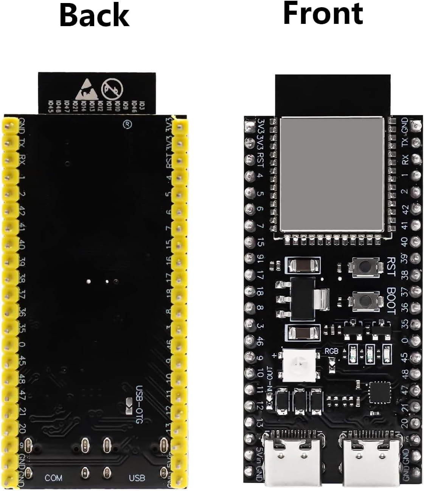
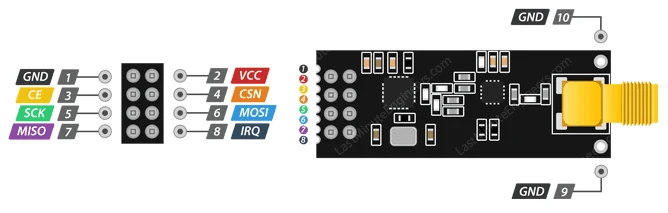
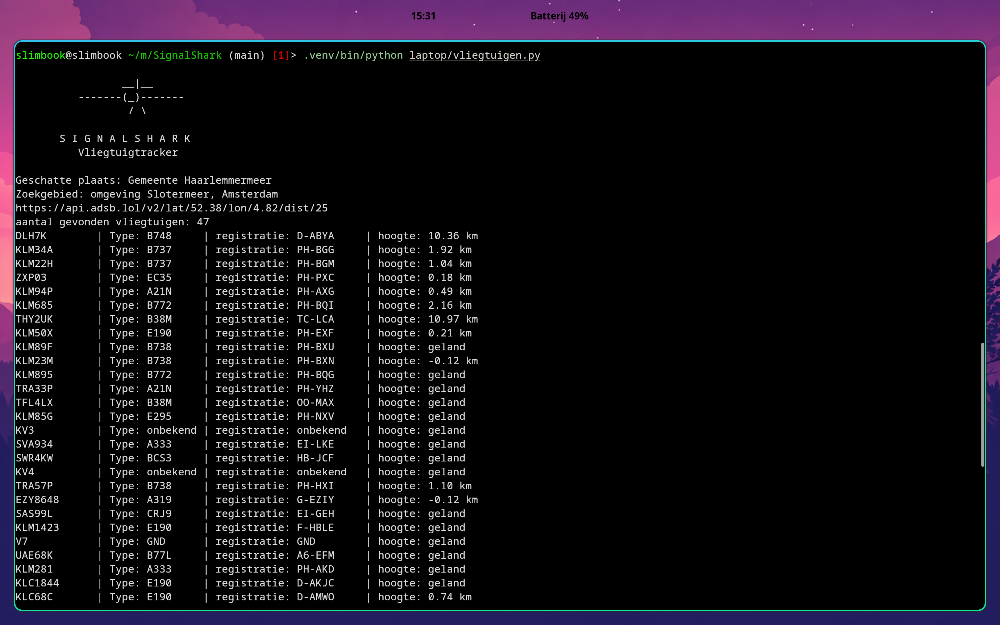

# SignalShark — My Build Journey

SignalShark is my ongoing project for exploring wireless signals and tracking aircraft and satellites.

I’m building it step by step while learning C++ and Python. This README documents how I started, what I have built so far, and what I want to add next.

## How it started

I started with an ESP32-S3 and two nRF24L01+ PA/LNA modules. My first idea was to receive aircraft signals and build an ADS-B tracker.

While researching the hardware, I learned that the nRF24L01 operates on 2.4 GHz and cannot receive the 1090 MHz ADS-B signals used by aircraft in Europe.

That changed my approach: use the ESP32 for local wireless measurements and retrieve aircraft positions from the internet on my laptop.

## Getting the ESP32 working

My first step was setting up Arduino IDE and uploading a small program that printed a message every two seconds.

Getting serial output working took some troubleshooting. My board has two USB connections, and I learned that the USB CDC setting needs to match the connection being used.

Once I could see my own message in the Serial Monitor, I had a working starting point.

### My ESP32-S3 board

### Pin diagram reference

I started learning how to read GPIO labels and distinguish data pins from power connections.

This diagram is a reference, not a completed wiring plan for the project.

## Learning the basics

Before building the scanner, I practised with small programs:

- Printing text with `Serial.print()` and `Serial.println()`.
- Creating a counter with a variable.
- Comparing values using `if` and `else`.
- Repeating actions with loops.
- Creating functions and returning values.

I wanted to understand each change rather than just copy a complete program.

## Building the Wi-Fi scanner

Next, I used the ESP32’s built-in Wi-Fi to scan nearby networks.

I first displayed only the number of networks found. Then I gradually added:

- Network names.
- Signal strength in dBm.
- Wi-Fi channels.
- Strong, moderate, and weak signal labels.
- Numbered results.
- Scan duration.

I learned that a signal of −40 dBm is stronger than −80 dBm, and that a Wi-Fi channel tells me where a network operates in the frequency band.

I also moved the signal rating into its own function, so the scanning code became easier to read.

## Adding a serial menu

Instead of scanning continuously, I added commands through the Serial Monitor:

| Command | Action |
|---|---|
| `w` or `W` | Start a Wi-Fi scan |
| `m` or `M` | Display the menu |
| `h` or `H` | Display help |

I added a message for unknown commands and learned to ignore the line-ending characters sent when pressing Enter.

A small formatting issue also taught me why `print()` keeps output on the same line while `println()` starts a new one.

The scanner is currently controlled from my laptop over USB.

## Planning the radio hardware

I explored adding an nRF24L01 module to monitor activity in the 2.4 GHz band.

This part is not connected yet. The modules have no readable pin labels, so I still need to confirm their pinout and arrange a suitable 3.3 V supply before wiring them.

I also looked into jumper wires, female headers, and a prototyping board for a later build.

The planned radio activity monitor will detect activity above a threshold. It will not identify devices or measure exact signal strength.

## Starting the aircraft tracker

While the radio hardware was on hold, I started a separate Python program on my laptop.

I created a virtual environment and began with a simple terminal message. Then I added:

- `urllib.request` to request internet data.
- `json` to read API responses.
- An IP-location lookup.
- A request to ADSB.lol for nearby aircraft.

### Learning about IP location

The IP-location service reported Haarlemmermeer while I was in Amsterdam.

That showed me that IP location is only an estimate. For now, the aircraft search uses an approximate, manually configured point near Slotermeer, with a radius of 25 nautical miles.

Automatic location selection and manual correction are still future improvements.

## Displaying aircraft

The first successful request returned a count of nearby aircraft.

I then added a loop to display each aircraft’s callsign. When only one callsign appeared, I learned that Python indentation determines whether a statement runs inside or outside a loop.

After fixing that, I added aircraft type codes and aligned the output into columns.

Finally, I added an ASCII aircraft banner to give the terminal program its own identity.

### Current terminal output

The screenshot shows one snapshot of the returned data. Counts and available information change between requests.

## Where the project is now

I currently have two working parts:

### ESP32 Wi-Fi scanner

It scans nearby 2.4 GHz Wi-Fi networks and displays their names, channels, signal strengths, and signal ratings through a USB serial menu.

### Python aircraft viewer

It fetches aircraft data around a configured location and displays the returned count, callsigns, and aircraft type codes when available.

These programs still run separately. The aircraft viewer uses internet data; it does not receive aircraft transmissions through the ESP32 or nRF24.

Departure and destination information, satellite tracking, and a combined interface are not implemented yet.

## What I want to build next

- Show aircraft altitude, speed, and distance.
- Look up departure and destination airports where free data permits.
- Improve error handling for failed internet requests.
- Add ISS and satellite information.
- Confirm the nRF24 wiring and build the radio activity monitor.
- Bring the features together in a laptop interface.
- Explore an optional touchscreen after the main features work.

## What I’m learning

This project is helping me learn:

- C++ and Arduino development.
- Python and indentation.
- Serial communication.
- APIs and JSON.
- Radio frequencies and hardware interfaces.

## Data sources

- [ADSB.lol](<https://www.adsb.lol/docs/open-data/api/>) — aircraft data, published under ODbL 1.0.
- [IPWhois](<https://ipwhois.io/documentation>) — approximate IP-based location.

***

**Status: actively learning and building.**
